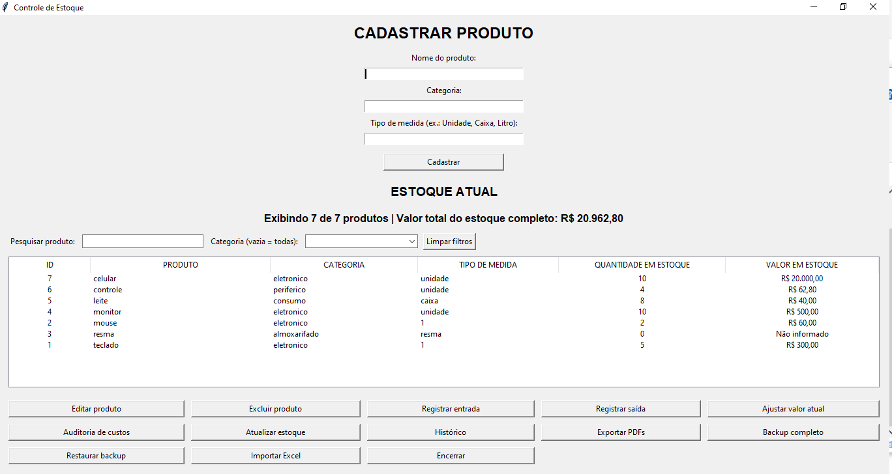
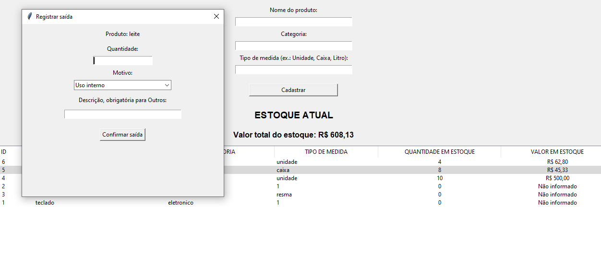
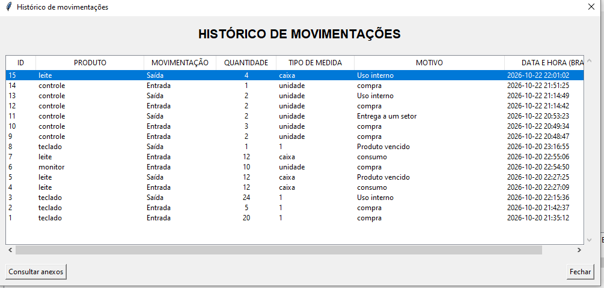

# Controle de Estoque

Aplicação desktop em Python para controlar produtos, entradas, saídas e o valor do estoque pelo custo de compra.

**Autor:** Thiago Dantas  
**Status:** Em desenvolvimento  
**Plataforma:** Windows, com banco de dados local

## Sobre o projeto

Desenvolvo este sistema para aplicar meus estudos de Análise e Desenvolvimento de Sistemas a uma necessidade prática: acompanhar os produtos disponíveis, suas movimentações e os custos do estoque.

O projeto é construído por etapas, com apoio de IA para orientação, explicações e revisão do código. Implemento e testo as funcionalidades enquanto estudo Python, SQL, interfaces gráficas e controle de versão.

## Funcionalidades implementadas

- Cadastro de produtos com nome, categoria e tipo de medida.
- Consulta das quantidades e dos valores disponíveis.
- Entradas com custo unitário de compra e motivo.
- Saídas com motivos predefinidos.
- Bloqueio de retiradas superiores ao saldo disponível.
- Cálculo das saídas pelo custo médio.
- Valor total do estoque, com indicação de custos ainda não informados.
- Histórico de movimentações com horário de Brasília.
- PDFs opcionais vinculados às entradas e saídas.
- Consulta e abertura dos anexos pelo histórico.
- Exportação conjunta dos PDFs.
- Backup completo em ZIP com banco, anexos e planilha Excel.
- Leitura de Excel com prévia dos dados.

A importação do Excel ainda não grava os dados no estoque. Essa etapa está em desenvolvimento.

## Exemplo de funcionamento

| Movimentação | Quantidade disponível | Valor em estoque |
|---|---:|---:|
| Entrada de 2 unidades a R$ 10,00 | 2 | R$ 20,00 |
| Entrada de 3 unidades a R$ 20,00 | 5 | R$ 80,00 |
| Saída de 2 unidades pelo custo médio de R$ 16,00 | 3 | R$ 48,00 |

Os dados deste exemplo são fictícios.

## Tecnologias

| Tecnologia | Aplicação |
|---|---|
| Python | Regras e integração do sistema |
| Tkinter e ttk | Interface gráfica |
| SQLite e SQL | Armazenamento e consultas |
| Decimal | Cálculos monetários |
| openpyxl | Leitura e geração de Excel |
| pathlib, shutil e uuid | Organização dos anexos |
| zipfile e tempfile | Backup completo |
| Git e GitHub | Controle de versão |

## Aprendizados

- Funções, condições, laços e tratamento de exceções.
- Consultas SQL com JOIN, SUM, CASE e GROUP BY.
- Transações com commit e rollback.
- Relacionamento entre produtos, movimentações e anexos.
- Validação de quantidades e valores.
- Eventos e atualização de componentes da interface.
- Manipulação de arquivos e criação de backups.
- Custo médio e arredondamento monetário.
- Commits e organização de repositórios.

## Demonstração

Capturas da versão em desenvolvimento, utilizando dados de teste.

### Tela principal

Cadastro de produtos, consulta das quantidades disponíveis
e acompanhamento do valor total do estoque.

### Registro de saída

Seleção do produto, quantidade, motivo e descrição.
O sistema verifica o saldo antes de confirmar a retirada.

### Histórico de movimentações

Consulta das entradas e saídas, com quantidade, motivo,
data e acesso aos PDFs anexados.

## Próximas melhorias

- [ ] Edição dos produtos e do custo inicial, com registro das alterações.
- [ ] Estorno de movimentações.
- [ ] Busca por nome e filtros por categoria.
- [ ] Exibição do custo médio na tela e dos custos no histórico.
- [ ] Importação completa do Excel com validação e confirmação.
- [ ] Restauração de backups.
- [ ] Inicialização automática de uma instalação nova.
- [ ] Melhorias visuais e testes finais.
- [ ] Executável e instalador para Windows.

## Código-fonte e privacidade

Este repositório apresenta o projeto publicamente.
O código-fonte permanece em um repositório privado.

Bancos de dados, documentos pessoais e backups não são publicados nesta vitrine.

A versão atual funciona localmente em um computador e ainda não possui instalador distribuído.

## Autor

**Thiago Dantas**  
Estudante de Análise e Desenvolvimento de Sistemas.

[Meu perfil no GitHub](https://github.com/gromjow10)
